# Poly Haven: Apparel & Personal Items models

**18 assets from [Poly Haven](https://polyhaven.com), dedicated to the public domain under [CC0](https://polyhaven.com/license).** Use them in any game, free or paid, and change them however you like; no credit is needed.

3D models as glTF at 1K and 2K texture resolution, each folder self-contained (`.gltf`, `.bin`, `textures/`). 162.0 MB in all.

This is a copy kept by [zuujis-cc0](https://github.com/zuujis-cc0) so game makers can take single files from GitHub. It is not made by or affiliated with Poly Haven: the originals, often in more formats and higher resolutions, are on [polyhaven.com](https://polyhaven.com). If they help you, consider [supporting Poly Haven](https://www.patreon.com/polyhaven/overview).

Every file is listed in [MANIFEST.tsv](MANIFEST.tsv) with its size and SHA-256. More free assets: [the Zuujis collection](https://github.com/zuujis-cc0/free-game-assets#readme).

| | | | |
| :-: | :-: | :-: | :-: |
| <a href="cigarette_case">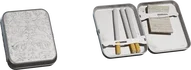</a> <b><a href="cigarette_case">Cigarette Case</a></b> by Michał Wiśniewski · <a href="https://polyhaven.com/a/cigarette_case">source</a> |  <b><a href="cigarette_pack">Cigarette Pack</a></b> by Ulrich Büch · <a href="https://polyhaven.com/a/cigarette_pack">source</a> |  <b><a href="digital_wrist_watch">Digital Wrist Watch</a></b> by Adrian C · <a href="https://polyhaven.com/a/digital_wrist_watch">source</a> | <a href="fishermans_hat">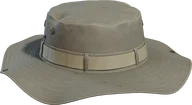</a> <b><a href="fishermans_hat">Fishermans Hat</a></b> by PierreB3D · <a href="https://polyhaven.com/a/fishermans_hat">source</a> |
| <a href="garden_gloves_01">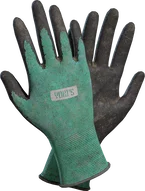</a> <b><a href="garden_gloves_01">Garden Gloves 01</a></b> by Satyaki Mandal · <a href="https://polyhaven.com/a/garden_gloves_01">source</a> |  <b><a href="life_jacket">Life Jacket</a></b> by PierreB3D · <a href="https://polyhaven.com/a/life_jacket">source</a> | <a href="medical_box">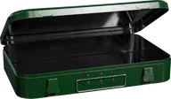</a> <b><a href="medical_box">Medical Box</a></b> by Ulan Cabanilla · <a href="https://polyhaven.com/a/medical_box">source</a> |  <b><a href="medical_tape">Medical Tape</a></b> by Miroslav Turura · <a href="https://polyhaven.com/a/medical_tape">source</a> |
|  <b><a href="old_gas_mask">Old Gas Mask</a></b> by Michał Wiśniewski · <a href="https://polyhaven.com/a/old_gas_mask">source</a> | <a href="pocket_watch">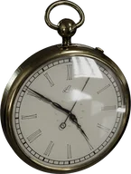</a> <b><a href="pocket_watch">Pocket Watch</a></b> by PierreB3D · <a href="https://polyhaven.com/a/pocket_watch">source</a> | <a href="round_spectacles">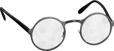</a> <b><a href="round_spectacles">Round Spectacles</a></b> by Sean Buckley · <a href="https://polyhaven.com/a/round_spectacles">source</a> | <a href="rubber_boots">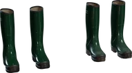</a> <b><a href="rubber_boots">Rubber Boots</a></b> by L · <a href="https://polyhaven.com/a/rubber_boots">source</a> |
| <a href="seadogs_compass">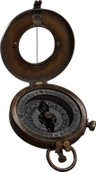</a> <b><a href="seadogs_compass">Seadogs Compass</a></b> by Benny Weimer · <a href="https://polyhaven.com/a/seadogs_compass">source</a> | <a href="vintage_crutches_01">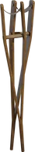</a> <b><a href="vintage_crutches_01">Vintage Crutches 01</a></b> by James Ray Cock · <a href="https://polyhaven.com/a/vintage_crutches_01">source</a> | <a href="vintage_lighter">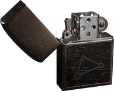</a> <b><a href="vintage_lighter">Vintage Lighter</a></b> by Slinc · <a href="https://polyhaven.com/a/vintage_lighter">source</a> | <a href="vintage_pocket_watch">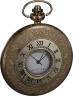</a> <b><a href="vintage_pocket_watch">Vintage Pocket Watch</a></b> by Tal Swicegood · <a href="https://polyhaven.com/a/vintage_pocket_watch">source</a> |
| <a href="vintage_suitcase">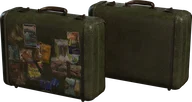</a> <b><a href="vintage_suitcase">Vintage Suitcase</a></b> by Maximilian Schuster · <a href="https://polyhaven.com/a/vintage_suitcase">source</a> | <a href="wheelchair_01">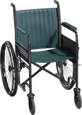</a> <b><a href="wheelchair_01">Wheelchair 01</a></b> by Garreth Dean · <a href="https://polyhaven.com/a/wheelchair_01">source</a> |  |  |

---

Kept up to date by this repository's own [update workflow](.github/workflows/update.yml), with code and plan from [cc0-mirror](https://github.com/zuujis-cc0/cc0-mirror). Something wrong? [Open an issue there](https://github.com/zuujis-cc0/cc0-mirror/issues/new) or use the [private report form](https://games.zuujis.com/report).
